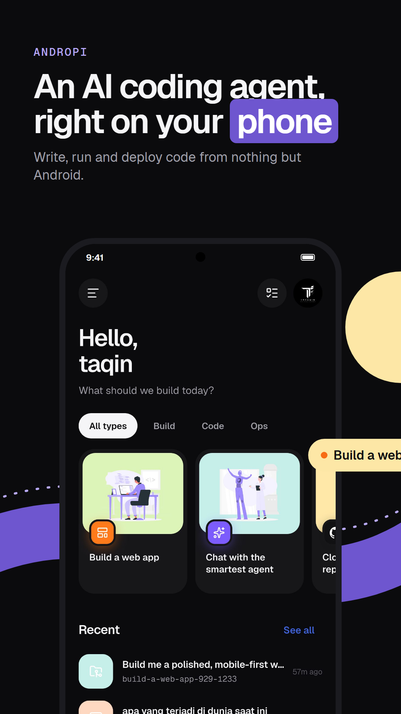

<p align="center">
  
</p>

<h1 align="center">GripHub AI Agent</h1>

<p align="center">An AI coding agent that runs on your Android phone.<br>
Write, run, preview and deploy code without a laptop.</p>

<p align="center">
  <a href="https://github.com/seseegy/griphub-releases/releases/latest"><b>APK downloads</b></a> ·
  <a href="https://github.com/seseegy/griphub"><b>Source</b></a>
</p>

<p align="center">
  
</p>

GripHub AI Agent puts the [pi coding agent](https://github.com/earendil-works/pi) on Android. The agent runs
locally in a bundled Node.js runtime. It reads and writes files, runs shell commands in a real Debian or Alpine
container, searches the web, and ships your project to GitHub Pages, Vercel or your own server.

Chat runs through [GripHub Router](https://griphubrouter.web.id) (`griphubrouter.web.id/v1`, OpenAI-compatible):
one API key unlocks 50+ models — Claude, GPT, Gemini, DeepSeek, GLM, Kimi, Qwen and more. Usage is billed in
GripHub credits (1 credit = Rp 300); the Usage screen shows live balance, credit cost estimates per model, and
the nearest credit expiry. Other OpenAI-compatible endpoints can be added as custom providers.

## Privacy in one paragraph

The app developer collects nothing and runs no server. Every chat you send goes to GripHub Router, which
processes it as a service (see the [Privacy Policy](docs/privacy.html) for the full table of where data goes).
Your GripHub API key, GitHub/Vercel tokens and SSH keys are encrypted on the device with a key held by the
Android Keystore. Backups are created only when you ask for them. Server mode (optional) runs the agent on a server of
your own over SSH instead of on the phone; your data then lives on that server, and push notifications, if you turn
them on, go through ntfy with a generic title only.

## Features

- **Chat with a coding agent.** Replies stream in real time, with code blocks, tool calls and a live HTML
  preview that updates while the agent writes the page.
- **Linux container.** Debian or Alpine through proot, so `apt`, `pip` and `npm` work. It is on by default and is
  the agent's shell.
- **Projects.** Each chat can use its own folder, or you can open any folder on the phone. The app includes a file
  explorer, a code editor, project search, a diff view and a checkpoint/undo for every agent run.
- **Git and GitHub.** Sign in with GitHub's device code (or a token), then clone repositories, commit, push, pick
  branches, turn issues into pull requests and follow GitHub Actions runs. Distributed builds point device login
  at their own OAuth App: create one with Device Flow enabled and paste its Client ID in Accounts → GitHub
  OAuth client ID — no rebuild needed.
- **Deploy.** GitHub Pages, Vercel, or SSH/rsync to your own servers. Dev servers can be shared with a public tunnel.
  Pages and Vercel deploys always show the destination (repository + visibility) for confirmation first, and
  upload only the folder you chose.
- **Terminal.** Multi-tab terminal with SSH to saved servers.
- **Agent controls.**
  - Approval modes: ask for everything, ask for risky actions only, or bypass all approvals.
  - Plan mode, message queue, and fork or edit-and-resend on any message.
  - Background tasks and schedules, and background jobs: a long command runs while the agent goes on, and its
    result calls the chat back.
  - MCP servers, skills (with a searchable skills catalogue), prompt templates and slash commands.
- **Everyday use.**
  - Image and file attachments (paste a copied picture too), and voice input.
  - Share to GripHub from other apps; home screen widget and Quick Settings tile.
  - Notifications.
  - Usage and cost estimates in GripHub credits and rupiah, and automatic fallback to another model.
  - App lock, encrypted tokens, and backup and restore.
  - Themes and accents, English and Bahasa Indonesia.
- **Web search that survives DNS blocking.** DNS-over-HTTPS for the agent's network access.

## Build

Requirements: Flutter (stable), Node.js 20+, Python 3 with `lief` (`pip install lief`), the Android SDK/NDK, and an
Android 8+ device (arm64, armv7 or x86_64).

```bash
# 1. Native runtime: node, git, ssh, rsync, curl, proot, ... from the Termux repository, repackaged as jniLibs
#    for arm64-v8a, armeabi-v7a and x86_64 (pass ABI names to build only some)
python tool/bundle_runtime.py

# 2. The agent host (TypeScript), bundled into android/app/src/main/assets/agent.zip
cd agent && npm install && node build.mjs && cd ..

# 3. The app. Two flavors:
#    full: GitHub builds, with "All files access" so projects can live in any folder on the phone
#    play: Google Play builds, without it (projects live in the app's workspace)
flutter pub get
flutter build apk --flavor full --release --split-per-abi --target-platform android-arm,android-arm64,android-x64
flutter build appbundle --flavor play --release --target-platform android-arm,android-arm64,android-x64
```

Steps 1 and 2 generate files that are not in the repository (`jniLibs/`, `agent.zip`). Run them again after you
change `tool/` or `agent/`.

## Releases and updates

Every push to `main` runs [`.github/workflows/release.yml`](.github/workflows/release.yml): it builds the `full`
APKs (one per ABI), signs them with the release key from the repository secrets (`KEYSTORE_BASE64`,
`KEYSTORE_PASSWORD`, `KEY_ALIAS`, `KEY_PASSWORD`) and publishes a GitHub release. The version is the one in
`pubspec.yaml` with the patch and build numbers raised by the workflow run number, so every release is newer than
the last and installs over it.

A GitHub build checks this repository's latest release (Settings → About → App updates, and on its own every few
hours). The APK is downloaded by Android's download manager, so it keeps going when the app is closed and can be
cancelled at any time; its SHA-256 is checked before the installer opens.

## Layout

| Path | What it is |
| --- | --- |
| `lib/` | Flutter app (UI in `lib/ui`, agent client in `lib/agent`) |
| `agent/src/` | Node host that runs pi and talks to the app over JSON lines |
| `agent/skills/` | Skills bundled with the app |
| `android/` | Kotlin side: runtime extraction, foreground service, share targets, widget, tile |
| `tool/` | Runtime bundler and the `box` container launcher |
| `store/` | Store assets (English and Indonesian) |

## Credits

- [pi](https://github.com/earendil-works/pi): the coding agent (MIT)
- [Termux packages](https://github.com/termux/termux-packages): the Android builds of Node.js, git, OpenSSH, proot
  and other tools bundled at build time, each under its own license
- [Storyset](https://storyset.com): illustrations
- [Lucide](https://lucide.dev) and [Simple Icons](https://simpleicons.org): icons
- [Geist](https://vercel.com/font): fonts (OFL)

## License

[MIT](LICENSE)
